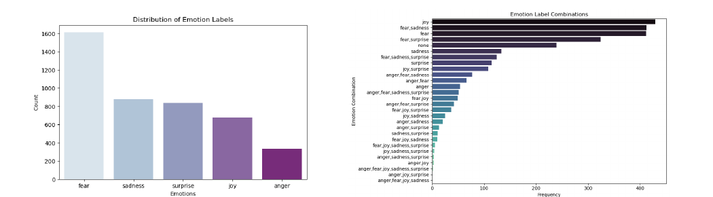
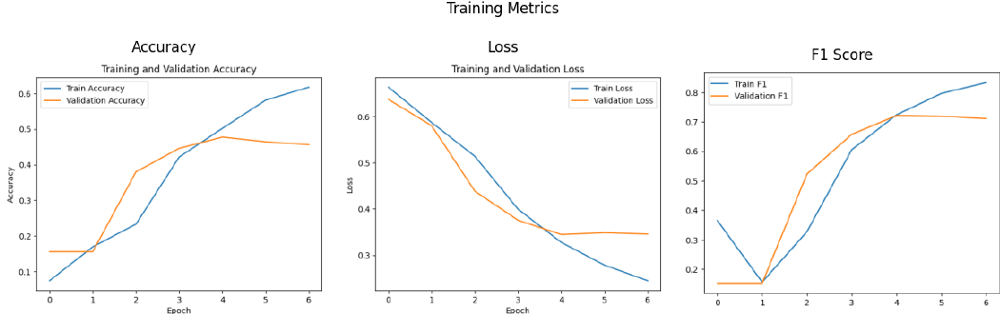

# Multi-label Emotion Detection with RoBERTa

Classifies English text into five emotions (**anger, fear, joy, sadness and surprise**), where a single sentence can express several emotions at once. A fine-tuned `roberta-base` model clearly outperformed classical machine learning, LSTM and ensemble approaches.

M.Sc. Data Science team project, Philipps-Universität Marburg.

## Results

| Model | Macro-F1 |
| --- | --- |
| **Fine-tuned RoBERTa (final model)** | **0.74–0.76** |
| Ensemble (classical + transformer) | 0.65 |
| Logistic Regression / SVC / Random Forest | 0.56 |
| LSTM | 0.35 |

The saved notebook run of the final RoBERTa model reaches a test **macro-F1 of 0.74**, **micro-F1 of 0.78** and a **Hamming loss of 0.157**. The run reported in our project report reached a macro-F1 of 0.76.

## Dataset

`track-a.csv` contains **2,768 English sentences**, each labelled with one or more of the five emotions (binary columns). The labels are strongly imbalanced: fear appears in more than 1,600 samples, anger in only about 330. Fear frequently co-occurs with sadness and surprise.



## Approach

- **Model:** `roberta-base` with a dropout layer and a linear classification head (5 outputs, one per emotion)
- **Loss:** `BCEWithLogitsLoss` for multi-label classification; sigmoid outputs thresholded at 0.5
- **Data split:** 75% training, 15% validation, 10% test (rows without any emotion label removed)
- **Fine-tuning strategy:**
  - Discriminative learning rates: 1e-5 for the encoder, 5e-5 for the classification head
  - Layer-wise unfreezing: head only in epoch 1, top 4 encoder layers from epoch 2, all layers from epoch 3
  - AdamW optimizer with a linear warm-up schedule, max sequence length 128, batch size 16
  - Early stopping (patience 2); the checkpoint with the best validation macro-F1 is kept
- **Evaluation:** accuracy, macro and micro F1, precision, recall, Hamming score and Hamming loss, per-class reports and qualitative error analysis



We skipped classical text preprocessing (stemming, lemmatization, stop-word removal) because RoBERTa performed best on raw text. Data augmentation (back-translation, synonym replacement) was tested but added noise and lowered performance.

## Repository contents

| File | Description |
| --- | --- |
| `model_notebook.ipynb` | Data analysis, training and evaluation notebook |
| `main.py` | Prediction script for new text |
| `track-a.csv` | Dataset |
| `requirements.txt` | Python dependencies |
| `*.png` | Figures used in this README |

## How to run predictions

1. Install the dependencies:

   ```bash
   pip install -r requirements.txt
   ```

2. Download the trained model weights [bert_emotion_best.pt](https://drive.google.com/file/d/1JCmoug1TNjgUn9sWY_wYYPSbeMF6uxlH/view?usp=sharing) and place the file in the same folder as `main.py`.

3. Run the script on a CSV file that has a `text` column:

   ```bash
   python main.py path_to_csv_file.csv
   ```

The predictions are printed to the terminal and saved to `test_result.csv`, with the original text and one binary column per emotion (1 = predicted, 0 = not predicted).

## Tech stack

Python · PyTorch · Hugging Face Transformers (RoBERTa) · scikit-learn · pandas · NumPy · matplotlib · seaborn

## Team

Adithya Sajan, Emilin Treesa Joseph, Navami Raj, Rahul Sunil Radhika, Roshin Raju John
